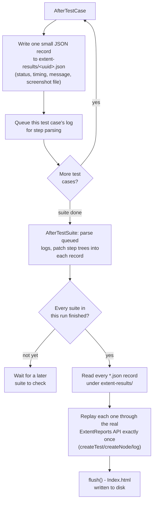

# Architecture

This document explains how the bridge is put together and why the harder
parts work the way they do. It assumes you've read the README's "Why this
exists" table - this goes one level deeper, into the actual mechanics.

## Integration point

Katalon Studio auto-discovers any class under `Test Listeners/` and invokes
methods annotated `@BeforeTestSuite` / `@BeforeTestCase` / `@AfterTestCase` /
`@AfterTestSuite` at the corresponding points in a run. That's the entire
integration surface - no plugin registration, no OSGi bundle, no build
step. `ExtentTestListener.groovy` is deliberately thin: four methods, each
one line, delegating straight to `ExtentReportBridge`. Katalon's listener
mechanism is the only part of this system Katalon actually has to know
about.

## Deferred report assembly

Extent Reports' API (`ExtentReports`, `ExtentTest`) is an in-memory object
model that gets serialized to HTML by calling `flush()` - there's no
built-in way to write one file per test case and combine them later.
Extent Reports 5.x does ship an official mechanism for cross-run merging
(`ExtentReports.createDomainFromJsonArchive`, paired with `JsonFormatter`),
but it doesn't work reliably on JDK 17+: Gson's reflective deserializer
trips `InaccessibleObjectException` against the module system when
rebuilding `Throwable` fields (see
[extent-framework/extentreports-java#331](https://github.com/extent-framework/extentreports-java/issues/331)).

That matters here because a Katalon Test Suite Collection can run its
member suites in genuinely separate OS processes, each with its own
short-lived JVM - there is no single long-running process that could hold
one live `ExtentReports` object across the whole run even if the timing
issue above didn't exist. So this bridge never builds a live
`ExtentReports`/`ExtentTest` object graph mid-run, and never touches
`createDomainFromJsonArchive` at all. Instead:

Every test case's outcome is durable on disk the moment it's known, and the
real Extent Reports API is only ever exercised once per run, in whichever
suite's process is determined to be the last to finish - see "Deciding when
to generate the report" below for how that's determined. Two consequences
worth being explicit about:

- **No in-memory state has to survive across Katalon's execution phases.**
  Each phase either writes a file or reads files written earlier - nothing
  needs a live object to persist between `BeforeTestSuite`, a `TestCase`,
  and `AfterTestSuite`, which matters because Katalon does not guarantee
  those phases share a call stack, a thread, or even a process.
- **Test Suite Collection support - including isolated-process member
  suites - falls out of this "for free".** Every process just writes its
  own JSON records to the same shared results directory on the filesystem,
  and whichever process's `AfterTestSuite` is determined to run last reads
  the whole directory and builds the report. No process-to-process
  communication beyond the shared filesystem is needed.

A single test case's own `BeforeTestCase` → body → `AfterTestCase` span is
not reliably single-threaded, so a test case's start time (and its buffered
manual `ExtentKeywords.step()` calls) are tracked in a plain static map
keyed by `testCaseId`, not a `ThreadLocal` set in `BeforeTestCase` and read
in `AfterTestCase` - that only requires the same JVM *process*, which is
always true within one suite, regardless of which thread Katalon happens to
dispatch each phase on. Once step capture has run, the timing is overwritten
with the authoritative value read straight from Katalon's own execution log
(`ILogRecord.getStartTime()`/`getEndTime()` on the matched
`TestCaseLogRecord`), the same source Katalon's own reports use. The one
remaining `ThreadLocal` (`currentTestCaseId`) only has to survive from
`startTestCase()` to that test case's own script body calling a keyword -
one continuous, in-order call on a single thread.

## Verifying the jar set

`com.aventstack:extentreports:5.1.2`'s own POM lists four dependencies:
RxJava3, FreeMarker, Lombok, and Gson. Shipping all four unmodified would
mean pulling whatever transitive dependencies each of them brings along
onto a Katalon project's classpath - unnecessary risk if some of them
aren't actually needed at runtime, so each is checked against what this
bridge actually calls rather than shipped by default:

- **RxJava3 and FreeMarker**: genuinely needed at runtime -
  `ExtentSparkReporter`/`ExtentReports` fail with `NoClassDefFoundError`
  without them. RxJava3 also pulls in one further runtime dependency of its
  own, not listed on extentreports' own POM:
  `org.reactivestreams:reactive-streams:1.0.4` (the Reactive Streams spec
  interfaces). Four jars total, not the two you might expect from
  `extentreports`' direct dependency list.
- **Lombok**: not needed at runtime, and not shipped. Lombok is a
  compile-time annotation processor - it generates real bytecode into
  `extentreports.jar`'s own compiled classes (its `@Getter`/`@Setter`
  usage), so nothing in the shipped jar references Lombok's own classes at
  runtime.
- **Gson**: not needed at runtime, and not shipped. Gson in
  `extentreports.jar` is only referenced by `JsonFormatter` and
  `JsonConfigLoader` - the exact two features this bridge deliberately
  never touches (see "Deferred report assembly" above). The
  `ExtentReports`/`ExtentSparkReporter`/`ExtentTest`/`MediaEntityBuilder`
  path this bridge actually uses has zero Gson references.

## Self-contained HTML

Extent's Spark reporter defaults to loading its CSS/JS/icons from a CDN
(`cdn.jsdelivr.net` or `extentreports.com`) - fine for a machine with
internet access, but not for offline use or for opening a report on a
machine with no internet connection at all.
`ExtentSparkReporterConfig.enableOfflineMode(true)` switches the generated
page to reference a local `spark/` folder instead; the CSS/JS/font/icon
files it copies there are bundled as resources inside `extentreports.jar`
itself, not downloaded. This bridge always enables it.

All test/step/category content is rendered directly into the static HTML
server-side - FreeMarker templates evaluate `${...}` expressions against
the report model at generation time, so the resulting `Index.html` is
already a complete, final document with nothing to fetch after the page
loads. Screenshots are embedded as inline base64 `data:image/...` (via
`MediaEntityBuilder.createScreenCaptureFromBase64String`), not as linked
files, so the whole report stays portable as an `Index.html` + `spark/`
folder pair - copy both, and it opens correctly anywhere, no server, no
internet connection.

Not a true single-file report (Spark's offline mode is a small folder, not
one file) - a true single-file mode would mean inlining `spark/`'s CSS/JS/
fonts directly into `Index.html` after generation, which this bridge
doesn't attempt. Folder-plus-file, opened directly via `file://`, is what's
shipped.

## Deciding when to generate the report

A Test Suite Collection should produce exactly one combined report,
written once every member suite has finished - not regenerated after each
one. `shouldGenerateReportNow()` determines this by comparing the number of
sub-suites Katalon planned for the run (read once from `plan.jsonl`, when
present) against how many distinct suite instances have reported
themselves complete so far, tracked in `.extent-collection-progress.txt`.
Falls back to `true` - generate every time - whenever either signal can't
be determined, which can only cause extra, harmless regenerations, never a
skipped one that matters.

## Locking across processes, not just threads

`withRunLock()` combines a `synchronized` block (for same-JVM threads) with
a real `FileLock` on `.extent-run.lock` under `extent-results/` (for
genuinely separate OS processes, which a Test Suite Collection's
`ISOLATED_PROCESS` suites can be). A `synchronized` block alone only
serializes threads inside one JVM - a Test Suite Collection running member
suites as separate OS processes needs the file lock to actually serialize
access across them; the `synchronized` block exists underneath it because
a second `FileLock` attempt from another thread in the *same* JVM throws
`OverlappingFileLockException` instead of blocking, so something still has
to queue same-JVM threads before they reach the file lock at all. Every
read or write of `.extent-run-marker.txt`,
`.extent-collection-progress.txt`, `.extent-pending-steps.txt`, and the
final read-every-record-and-generate step all happen inside it.

## Step-level detail

Turning a test case's execution log into a nested Extent step tree can't
happen inside that test case's own `AfterTestCase`: Katalon keeps the log
file open until every `AfterTestCase` listener registered for that test
case, not just this one, has returned. Reading it too early risks a
mid-write parse failure.

Instead, `AfterTestCase` only records a pending entry (test case ID, its
result UUID, its log folder) to `.extent-pending-steps.txt`.
`AfterTestSuite` processes every currently-pending entry - not just the
finishing suite's own - since whichever suite's `AfterTestSuite` runs first
ends up doing the work for others too when suites run concurrently. Parsing
uses Katalon's own `TestSuiteXMLLogParser` rather than a hand-rolled XML
parser: Katalon's execution logs can contain raw control characters that a
strict parser rejects outright, and Katalon's own parser already strips
them before parsing. The parsed result is converted into a plain nested
`Map`/JSON step tree - this bridge's own format, not Extent's - which gets
replayed into real `ExtentTest.createNode()`/`.log()` calls only at
final-generation time, consistent with the deferred-build design above.

A suite whose log only closes once its own `AfterTestSuite` call returns
creates a narrower timing gap that a short retry loop covers for every
suite except the last one in a run - which has no later suite left to hand
an unparsed entry to. That case falls to a bounded synchronous retry (up
to 20 attempts, one second apart) inside the final suite's own call
instead, rather than a background thread: a CI pipeline that runs one
suite per `katalonc` invocation exits the process almost immediately after
the listener returns, which would kill a background thread before it
finished.

Manual `ExtentKeywords.step()` calls are appended as their own log entries
alongside the auto-captured step tree, not positionally interleaved into
it - the deferred-build design has no live, in-order step stack available
during the test's own execution to interleave into (the step tree is only
assembled later, at final-generation time, from the JSON record).
Auto-capture (the zero-touch default) gets the full, correctly-ordered
step tree; opting into manual instrumentation adds detail rather than
replacing it, just not positionally merged with the automatic trace.

## Ordering suites in the report

`generateHtmlReport()` sorts suite groups alphabetically by
`bareSuiteName()` (case-insensitive) before replaying them. Start time is
the tiebreaker: first between repeat occurrences of the very same suite
name, then between test cases within one occurrence.

That Groovy-side sort controls the order tests are *created* in, which is
what the main Tests tab reflects (`Report.testList` is a plain
`Collections.synchronizedList`, insertion-ordered). It has no effect,
though, on the separate Suites (Author) tab's own card order: Extent's
`AuthorCtx` backing set is a
`Collections.newSetFromMap(new ConcurrentHashMap<>())` - a hash-ordered
set with no insertion or sort guarantee - and Extent's own template
renders it straight into static HTML at `flush()` time in whatever order
that set happens to iterate in. The Suites tab's card order is fixed up
separately, client-side, via the same `setJs()` injection used for the
label/timing overrides: the rendered `<li class="test-item">` cards are
re-sorted alphabetically by their visible name after Extent's own HTML has
already been built.

## Real timestamps vs. replay time

The deferred-build design means every test's real execution has already
finished, sometimes minutes earlier, by the time `replayTestCase()` calls
`ExtentReports.createTest()`/`ExtentTest.log()` for it. `ExtentTest`'s own
public API has no way to tell it "this happened at this specific past
time" - `createTest()` stamps the model with `new Date()` (replay time, not
real time) with no exposed setter to override it.

The fix: `ExtentTest.getModel()` is public and returns the live, mutable
`model.Test` object underneath, which does have real `setStartTime()`/
`setEndTime()`. Two things matter about how they're used:

- `setStartTime()` is safe to call immediately after `createTest()` -
  nothing overwrites it afterward.
- `setEndTime()` is **not** safe to call early: every `ExtentTest.log()`
  call re-stamps the model's `endTime` to "now" as a side effect (a
  reasonable design on Extent's part - it keeps "when did this test last do
  something" in sync with actual logging activity - but one that silently
  discards a manually-set value if set before the logging that follows it).
  So `setEndTime()` has to be the literal last thing done to a test's
  model, after every `log()`/`createNode()` call for it has already
  happened.

The same two rules apply one level down, to individual step nodes
(`addStepNode()`): each step created via `ExtentTest.createNode()` is
itself a full `ExtentTest` with its own independently-settable model, and
Katalon's own execution log already has real per-step start/end times
(`ILogRecord.getStartTime()/getEndTime()` on each `TestStepLogRecord`,
captured into the step tree by `convertLogRecordsToSteps()`) - so the same
setStartTime-immediately / setEndTime-last pattern applies per node, not
just once per test.

Not extended to individual log *entries* within a step (each
`test.log(status, details)` call's own row still shows replay time, not a
real timestamp) - `Log` objects do have a settable `timestamp` field at the
model level, but `ExtentTest.log()` doesn't hand back a reference to the
`Log` object it just created, so reaching it would need a further
`getModel()` dig into the model's own log list. Not implemented, since
test/suite and step-level timing were the ones that mattered; worth
revisiting if log-entry-level timing turns out to matter too.

### The Dashboard's aggregate "Started"/"Ended" cards are a separate case

Fixing per-test/per-step timing (above) does not fix the Dashboard tab's
own "Started"/"Ended" summary cards - these read from a *third*, report-
level timestamp (`Report.getStartTime()`/`getEndTime()`, reachable via the
public `ExtentReports.getReport()`/`AbstractProcessor.getReport()`), not
from any individual test's model. `Report.setStartTime()` sticks reliably
no matter when it's called. `Report.setEndTime()` does not - it resets to
the `flush()` instant during `flush()` itself, regardless of what was set
beforehand.

Rather than depend on Extent's own Java API for this one aggregate, the
true run window (`min(start)`/`max(stop)` across every record - already
computed correctly and used everywhere else) is written directly into the
two Dashboard cards client-side, via the same injected `setJs()` script
used for the Author → Suites tab relabeling below.

## Suite labels for repeated occurrences

When a Test Suite Collection runs the same underlying suite more than once
(e.g. the same suite listed twice with two different browsers), every
distinct occurrence Katalon actually ran stays its own separate group in
the report - two occurrences are never merged into one, whether they share
the same browser, a different browser, the same test cases, or a different
mix. `assignDisplayLabels()` groups by `suiteInstance`'s raw, per-occurrence
value - see `suiteInstanceKey()` below for how that value is derived - and
only cleans up the visible *label*: the occurrence's own browser replaces
Katalon's own opaque per-occurrence identifier where that's already enough
to tell two occurrences of the same suite apart (the common case), falling
back to a plain `#2`/`#3` ordinal - ordered by which occurrence actually
started first - only when even name+browser collide.

Grouping key is the raw `suiteInstance` value, not individual test-case
records: multiple test cases sharing one ordinary suite occurrence (e.g.
one "API Test Suite" occurrence running both an API-only test case with no
browser and a WebUI one with a browser) resolve to the same label, never
split across two different Author groups just because one of the test
cases doesn't use a browser. Browser also gets its own tag via
`ExtentTest.assignDevice()` - a real, separate Device view - independent of
what the Author label reads. Whether an occurrence's label gets a browser
suffix at all is based on whether *any* test case in that occurrence used
one, not just whichever test case happened to start first. The label uses
only the suite's own leaf name (`bareSuiteName()`), not the full Test
Suites folder path `suiteInstance` otherwise carries (e.g. "FolderSuite",
not "TestSuitesFolder/FolderSuite") - the folder-qualified value is still
what's used internally to key grouping, so a same-named suite nested in a
different folder is never merged with it; only the display text is
shortened.

One thing this bridge cannot control: the tab itself is still labeled
"Author" in the UI, because that string is hardcoded inside Extent's own
shipped template, not exposed through any public config API. Reusing
`assignAuthor()` for suite grouping is a deliberate repurposing of an
existing Extent feature rather than building a custom view from scratch;
the label itself is relabeled to "Suites" client-side via the same
`setJs()` injection mentioned above.

### suiteInstanceKey() and per-occurrence identity

`suiteInstanceKey()` derives a suite occurrence's identity from its own
report folder path, relative to the run's root, and keeps the trailing
per-suite-run timestamp segment as part of that identity, rather than
stopping short of it.

That matters because Katalon does not reliably add a disambiguating suffix
to the report folder *name* for a repeated suite in console-mode execution
- two occurrences of the same suite can both write to
`.../<suite name>/<own timestamp>`, an identical folder name, distinct only
by the timestamp subfolder. Keeping that segment, rather than assuming a
folder-name suffix always exists, is what actually tells two such
occurrences apart; `bareSuiteName()` strips it back out again for display,
stripping the timestamp segment before the hash-suffix pattern (for runs
where Katalon does add a folder-name suffix) rather than after - a
timestamp like `20260818_080402` is also a valid hex string, so running
the hash-suffix strip first would eat the last six digits of the timestamp
and leave the date attached to the wrong side of a slash. Both
`shouldGenerateReportNow()`'s completed-suite tracking and
`assignDisplayLabels()`'s grouping depend on this identity being genuinely
unique per occurrence, not just per suite name.

## Categories

`categories.json` defines named failure categories - `name`,
`matchedStatuses`, `messageRegex`, `traceRegex` - matched against each
test's status and failure message at final-generation time in plain
Groovy, tuned for Katalon/Selenium exception classification (Object
Repository issues, timeouts, assertion failures, environment/
infrastructure issues, script/data issues). Applied through Extent's own
tag system (`ExtentTest.assignCategory(...)`), visible in the Spark
report's own Categories/Tags view. A test can match more than one
category.

## Status mapping

Extent's `Status` enum has five levels - `INFO`/`PASS`/`WARNING`/`SKIP`/
`FAIL` - with no separate "broken" tier for a test that errored rather
than failed an assertion. Katalon's own `ERROR` and `INCOMPLETE` statuses
both map to `FAIL` here; the original Katalon status string is always
included in the logged detail text so it isn't lost, just not visually
distinguished from an assertion failure.

## Not implemented: history/trend

Standard Extent Spark reports show only the current run - no built-in
cross-run trend graph. The two paths that exist for building one:

- Extent's own official cross-run JSON merge
  (`createDomainFromJsonArchive`) - ruled out above (JDK 17+ issue).
- A from-scratch trend view: possible in principle (a lightweight
  run-history file plus a custom Spark view or a small separate trend
  page, built around a stable per-test identity so repeat runs of the same
  test line up across time), but genuinely new work, not something Extent
  Reports already does most of the job for. Not attempted in this phase.

## Failure isolation

One rule holds everywhere in `ExtentReportBridge`: every public entry
point catches `Throwable` and only logs a warning. A bug in report
generation must never fail, skip, or change the outcome of the real test
it's reporting on.

## Installer

Installing is a plain file copy into `Keywords/`, `Test Listeners/`,
`Include/`, and `Drivers/` - folders Katalon already auto-compiles and
auto-discovers regardless of a project's `.classpath` state, so a copied
file behaves identically whether the project is opened in the IDE, run
from `katalonc` on the command line, or run in CI. Every file the
installer writes is recorded in `<project>/.extent-bridge/manifest.txt`,
so uninstall removes exactly what was installed and nothing else -
generated `extent-results/`/`extent-report/` and a customized
`extent.properties` are kept by default.

## CI detection

Reads each platform's own standard environment variables directly
(`JENKINS_URL`, `TF_BUILD`, `GITHUB_ACTIONS`, `GITLAB_CI`) at
final-generation time - whichever one is set determines the executor name
and build link written into the report's System/Environment panel via
`ExtentReports.setSystemInfo(...)`, with a local, non-CI run as the
fallback.
