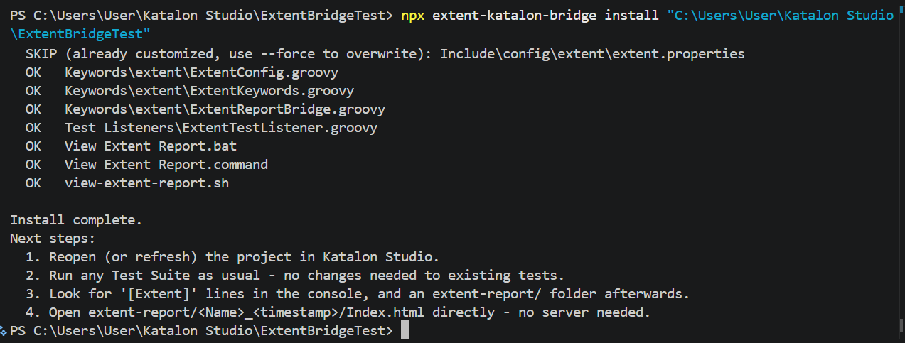
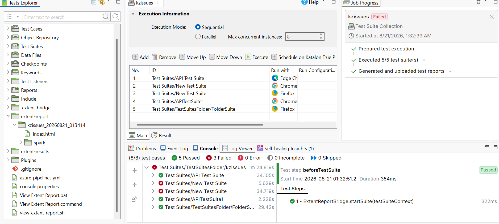
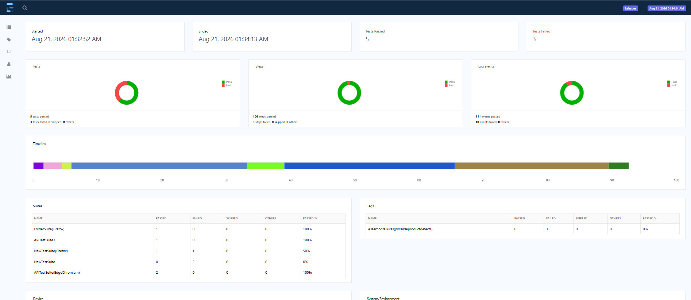
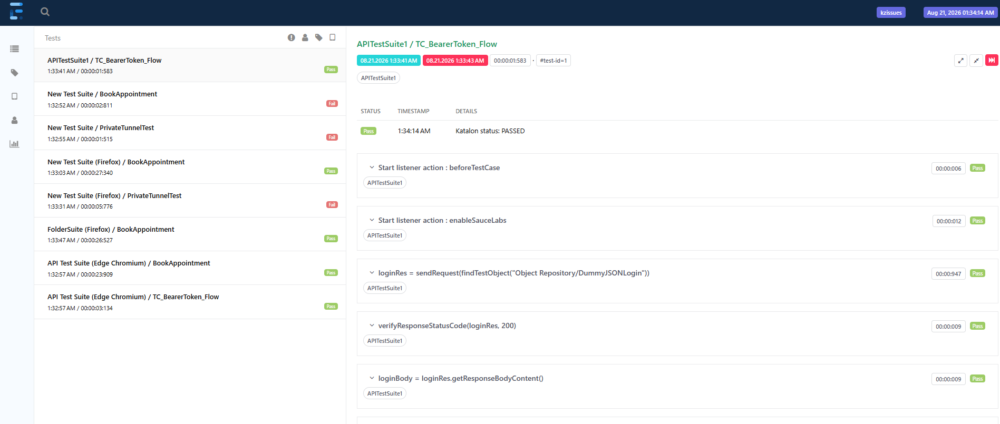
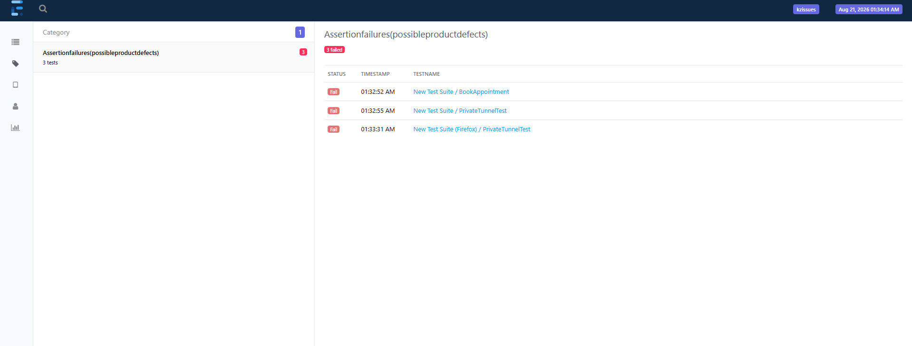
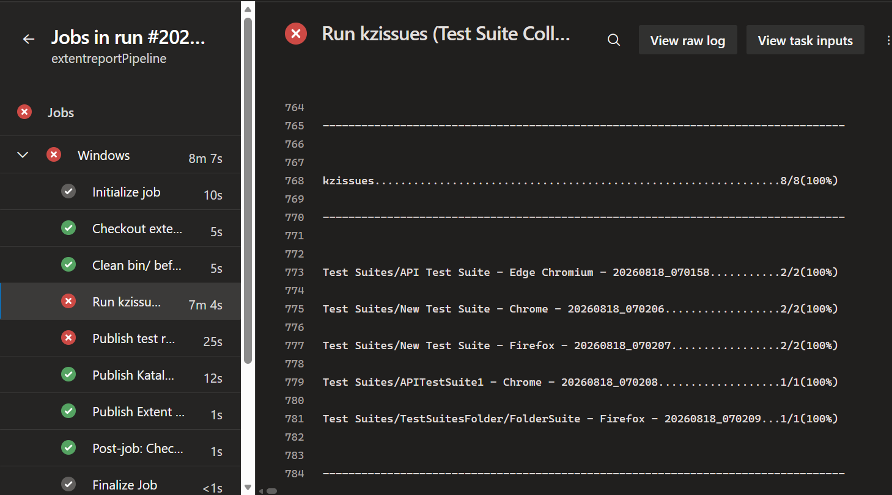
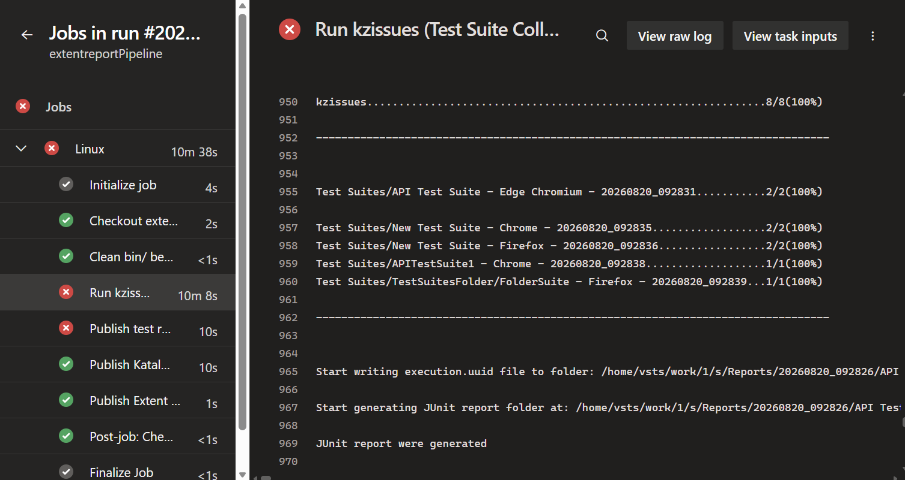
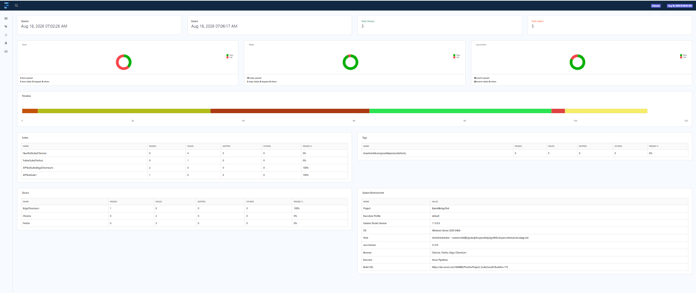
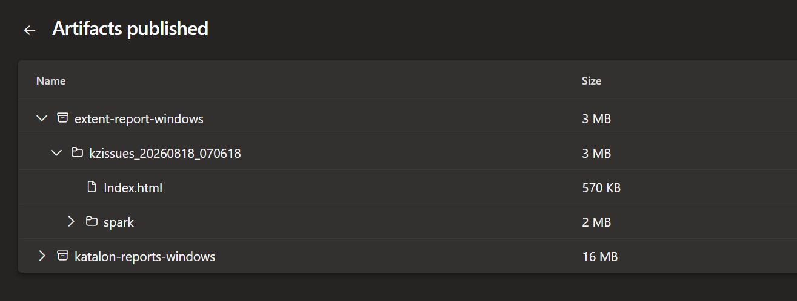
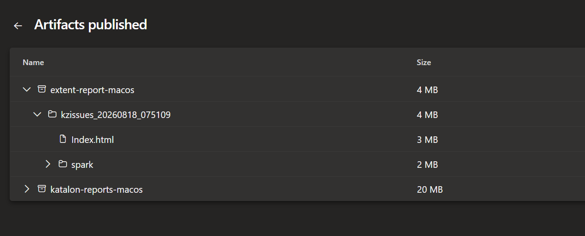

# Extent-Katalon Bridge

[](https://www.npmjs.com/package/extent-katalon-bridge)
[](LICENSE.md)

Turn any Katalon Studio project into an Extent Reports-reporting project by
double-clicking one file - no plugin installation from the Katalon Store, no
manual Test Listener authoring, no `CustomKeywords` calls pasted into your
test cases, no changes to existing Test Cases or Test Suites.

See [`ARCHITECTURE.md`](ARCHITECTURE.md) for how this is actually built
under the hood.

**A note on Extent Reports itself:** its maintainer marked the project
sunset in early 2025, in favor of a successor project called ChainTest.
The version this bridge uses (5.1.2) still works fully and isn't going
anywhere, but it won't receive further updates from its own maintainer.
Worth factoring in if you're choosing a reporting library for the long
term.

## See It in Action

**1. Install with one command**



**2. Run your test suite or collection like you always do**


**3. The Extent report is generated automatically, right inside Katalon Studio**



**4. Open it and get the full picture - dashboard, steps, categories, suites**

<table>
<tr><th>Dashboard</th><th>Tests &amp; steps</th><th>Categories</th><th>Suites</th></tr>
<tr>
<td></td>
<td></td>
<td></td>
<td></td>
</tr>
</table>

## Verified in CI

The same Test Suite Collection runs unmodified on Azure Pipelines hosted
agents for Windows, macOS, and Linux - same YAML steps, no
platform-specific test changes. Full example in
[`azure-pipelines.example.yml`](azure-pipelines.example.yml).

**The pipeline itself, running on hosted agents**

<table>
<tr><th>Windows</th><th>macOS</th><th>Linux</th></tr>
<tr>
<td></td>
<td></td>
<td></td>
</tr>
</table>

**Each platform produces its own Extent report, environment details and all**

<table>
<tr><th>Windows</th><th>macOS</th><th>Linux</th></tr>
<tr>
<td></td>
<td></td>
<td></td>
</tr>
</table>

**And published as downloadable pipeline artifacts, ready to open from the run itself**

<table>
<tr><th>Windows</th><th>macOS</th><th>Linux</th></tr>
<tr>
<td></td>
<td></td>
<td></td>
</tr>
</table>

## Why this exists

Katalon Studio does have an official Extent Reports integration - but it's
the opposite of zero-touch: install a plugin from the Katalon Store, write
your own Test Listener by hand, and paste an explicit
`CustomKeywords.'com.katalon.extent.report.ExtentReport.attachLog'()` call
into every test case script you want logged.

| Problem with the official plugin path | How this bridge solves it |
|---|---|
| Install from the Katalon Store, keep its jar version in sync with your Katalon version | Ships the exact jars it needs directly in the project - no Store, no OSGi plugin packaging at all |
| Write your own Test Listener by hand | Ships a pre-wired one - `Test Listeners/ExtentTestListener.groovy` |
| Paste an explicit `attachLog()`/`CustomKeywords` call into every test case you want logged | Auto-converts Katalon's own per-test-case execution log into nested Extent steps - zero-touch by default |
| A reporting bug could fail or change the outcome of a real test | Every hook catches its own exceptions and only logs a warning |

## Requirements

- Katalon Studio (built and tested against its Java 17/21 runtime)
- Windows, macOS, or Linux. On Linux, Katalon 11.3.0's OSGi bundles require
  JavaSE 21; most hosted CI Ubuntu images default to an older JDK, so pin
  `JAVA_HOME` to a JDK 21 install explicitly in that environment (see CI
  setup below)
- Nothing else - no external commandline tool to install. Report
  generation happens entirely in-process using the four jars in
  `payload/Drivers/`

## Install / Uninstall

<details>
<summary><b>📦 npm (any OS)</b></summary>

Needs Node.js. Works identically on Windows, macOS, and Linux.

```
npx extent-katalon-bridge install "/path/to/your/katalon/project"      # add --force to also overwrite a customized extent.properties
npx extent-katalon-bridge uninstall "/path/to/your/katalon/project"    # add --remove-config to also delete extent.properties/categories.json
```

`npx` fetches and runs it without installing anything globally. To install
it once and reuse it: `npm install -g extent-katalon-bridge`, then run
`extent-katalon-bridge install ...` directly.
</details>

<details>
<summary><b>🪟 Windows/</b></summary>

**Just click:** double-click **`Windows\Install.bat`**, then pick your
Katalon project folder in the dialog that opens. Uninstall the same way
with **`Windows\Uninstall.bat`**.

**Drag-and-drop:** drop your project folder onto `Install.bat` (or
`Uninstall.bat`) to skip the dialog entirely.

**Scripted / CI** (run from the repo root):
```powershell
.\Windows\install.ps1 -ProjectPath "C:\path\to\your\katalon\project"      # add -Force to also overwrite a customized extent.properties
.\Windows\uninstall.ps1 -ProjectPath "C:\path\to\your\katalon\project"    # add -RemoveConfig to also delete extent.properties/categories.json
```
</details>

<details>
<summary><b>🍎 macOS/</b></summary>

**Just click:** double-click **`macOS\Install.command`**, then pick your
Katalon project folder in the dialog that opens. Uninstall the same way
with **`macOS\Uninstall.command`**.

**Scripted / CI** - macOS shares the Linux bash engine below:
```bash
./Linux/install.sh /path/to/your/katalon/project      # add --force to also overwrite a customized extent.properties
./Linux/uninstall.sh /path/to/your/katalon/project    # add --remove-config to also delete extent.properties/categories.json
```
</details>

<details>
<summary><b>🐧 Linux/</b></summary>

```bash
./Linux/install.sh /path/to/your/katalon/project      # add --force to also overwrite a customized extent.properties
./Linux/uninstall.sh /path/to/your/katalon/project    # add --remove-config to also delete extent.properties/categories.json
```
Run either script with no path argument and it'll prompt you to paste one instead.
</details>

Uninstalling only removes what was installed, and keeps your
`extent.properties`/`categories.json` and any generated `extent-results/`
`extent-report/` in place unless you pass the force/remove-config flag
shown above.

## What the installer actually does

1. Verifies the target folder is a real Katalon project (looks for a
   `*.prj` file) before writing anything - refuses to run otherwise.
2. Copies the Test Listener, Keywords, config, and Drivers jars into it.
3. Leaves an existing, customized `extent.properties` alone (pass `-Force`
   / `--force` to overwrite it too).
4. Records everything it installed in `<project>/.extent-bridge/manifest.txt`,
   so uninstall can remove exactly that later - nothing else in the project
   is ever touched.
5. Registers the four Drivers jars in `.classpath` if one exists, so
   Katalon's editor resolves the Extent classes without a manual refresh.

Re-running install against the same project **upgrades** it in place.

## What gets installed

```
Test Listeners/ExtentTestListener.groovy       auto-discovered by Katalon - the only wiring needed
Keywords/extent/ExtentReportBridge.groovy      engine: lifecycle mapping, step capture, report assembly
Keywords/extent/ExtentConfig.groovy            extent.properties reader, with EXTENT_* env var overrides
Keywords/extent/ExtentKeywords.groovy          optional: step(), info/warning/pass/fail(), attachScreenshot()
Include/config/extent/extent.properties        configuration
Include/config/extent/categories.json          failure categorization tuned to Katalon/Selenium exception types
Drivers/extentreports-5.1.2.jar                Apache-2.0, Extent Framework
Drivers/freemarker-2.3.32.jar                  Apache-2.0, Apache Software Foundation
Drivers/rxjava-3.1.6.jar                       Apache-2.0, RxJava Contributors
Drivers/reactive-streams-1.0.4.jar             CC0 1.0 (public domain)
Drivers/fetch-extent-jars.ps1                  re-download the 4 jars from Maven Central (sha1-verified) if your org won't commit binaries to git
View Extent Report.bat / .command              optional convenience: opens the most recent report for you (Windows / macOS)
view-extent-report.sh                          same, for Linux/CI or manual use
```

### Do you actually need "View Extent Report"?

No. Every run writes its own self-contained
`extent-report/<Name>_<timestamp>/` folder - open `Index.html` inside it
directly in a browser, no server needed. `View Extent Report` is a
convenience that finds the newest one for you so you don't have to hunt
through timestamped folder names.

## Using it

**Zero-touch (default):** every test suite run automatically produces one
Extent Reports test entry per test case - status, timing, a failure
screenshot (WebUI only, embedded inline, no separate image files), the full
nested step tree pulled straight from Katalon's own execution log, and
automatic failure categorization (Object Repository issues, timeouts,
assertion failures, environment/infrastructure issues, script/data issues -
tuned for Katalon/Selenium, editable in `Include/config/extent/
categories.json`).

`<Name>` in the report path is a Test Suite Collection's name if you ran
one, otherwise the Test Suite's name, or a lone Test Case's own name if run
directly without a saved suite. A Test Suite Collection produces exactly
one combined report, not one per Test Suite. Suites are listed
alphabetically by name in the report's Suites tab; a suite that runs more
than once in one Collection (e.g. the same suite with two different
browsers) shows up as its own separate entry each time, labeled by browser
- or with no browser label at all if that particular occurrence never
actually opened one (an API-only run, or a WebUI session that failed to
start).

**Opt-in extra detail**, from inside a Test Case script or Cucumber glue:

```groovy
CustomKeywords.'extent.ExtentKeywords.step'('Log in as admin', {
    WebUI.setText(findTestObject('Page/input_Username'), 'admin')
    WebUI.click(findTestObject('Page/button_Login'))
})
CustomKeywords.'extent.ExtentKeywords.info'('Using seeded test account #4')
CustomKeywords.'extent.ExtentKeywords.attachScreenshot'('Before checkout')
```

This is a deliberately small, opt-in API - `step()` for nested detail,
`info`/`warning`/`pass`/`fail()` for a manual log line, and
`attachScreenshot()` for an extra capture. Nothing here is required; every
test case already gets a full report entry with zero code changes.

## Configuration

Edit `Include/config/extent/extent.properties` in the target project, or
override any key per environment with `EXTENT_<KEY_IN_UPPER_SNAKE_CASE>`
(e.g. `extent.results.dir` -> `EXTENT_RESULTS_DIR`):

| Key | Default | Meaning |
|---|---|---|
| `extent.enabled` | `true` | Master switch |
| `extent.results.dir` | `extent-results` | Working storage for intermediate per-test-case records - not meant to be read directly |
| `extent.clean.results.before.run` | `true` | Clear last run's records before each suite starts |
| `extent.attach.screenshot.on.failure` | `true` | Screenshot on any non-PASSED status (WebUI only) |
| `extent.attach.screenshot.always` | `false` | Screenshot on every test case |
| `extent.categories.file` | `Include/config/extent/categories.json` | Failure categorization template |
| `extent.auto.generate.report` | `true` | Assemble the HTML report at the end of the run - happens in-process, never shells out to a commandline |
| `extent.report.dir` | `extent-report` | Base folder for generated reports; each run writes its own `<Name>_<timestamp>/` folder here |
| `extent.report.theme` | `standard` | `standard` or `dark` |
| `extent.capture.steps` | `true` | Auto-convert Katalon's execution log into nested Extent steps |

## CI setup

`executor.json`-equivalent detection is automatic: the generated report's
System Info panel picks up Jenkins, Azure Pipelines, GitHub Actions, and
GitLab CI from each platform's own standard environment variables, so it's
clear which build produced it - nothing to configure for that part on any
of them.

This repo includes three ready-to-copy configs -
[`azure-pipelines.example.yml`](azure-pipelines.example.yml),
[`github-actions.example.yml`](github-actions.example.yml),
[`gitlab-ci.example.yml`](gitlab-ci.example.yml). Pick the one matching
your platform, copy it in under the filename your CI expects, fill in the
one TODO (your Test Suite or Test Suite Collection path), and add your
Katalon API key as described below.

### Azure Pipelines

1. Copy `azure-pipelines.example.yml` into your repo as `azure-pipelines.yml`.
2. Install the **"Execute Katalon Studio Tests"** extension from the Azure
   DevOps Marketplace if your organization doesn't already have it.
3. Under **Pipelines → Library**, create a variable group named `Katalon`
   with a secret variable `KatalonApiKey` holding your Katalon Runtime
   Engine API key (Katalon Store → Profile → API Key).
4. Replace `<YourCollection>` in the `executeArgs` line with your actual
   Test Suite Collection path (or swap `-testSuiteCollectionPath` for
   `-testSuitePath="Test Suites/<YourSuite>"` to run a single suite
   instead).
5. Commit and push - the pipeline runs on every push to `main`.

Reports show up on the pipeline run's **Summary** tab, in the small
"X published" artifacts panel near the top - both the raw Katalon output
(`katalon-reports`) and the generated Extent HTML (`extent-report`).

### GitHub Actions

1. Copy `github-actions.example.yml` into your repo as
   `.github/workflows/katalon-ci.yml`.
2. Under **Settings → Secrets and variables → Actions**, add a repository
   secret named `KATALON_API_KEY` with your Katalon Runtime Engine API key.
3. Replace `<YourCollection>` in the `args` line the same way as above.
4. Commit and push.

Reports show up on the **Actions** tab, under that run's summary page, in
the **Artifacts** section at the bottom. This example references the
bridge itself as a GitHub Action (`uses: montbaga/extent-katalon-bridge@v1`)
rather than `npx` - it works directly from a tagged release, with no
dependency on npm at all.

### GitLab CI

1. Copy `gitlab-ci.example.yml` into your repo as `.gitlab-ci.yml`.
2. Under **Settings → CI/CD → Variables**, add a variable named
   `KATALON_API_KEY` with your Katalon Runtime Engine API key, and check
   "Mask variable".
3. Replace `<YourCollection>` in the `script` line the same way as above.
4. Commit and push.

This one differs from the other two in one respect: it uses Katalon's own
official Docker image (`katalonstudio/katalon`) instead of downloading
Katalon onto a hosted VM, so it runs on **Chrome, not Edge** - adjust
`-browserType` and any browser-specific test logic accordingly.

Reports show up on the pipeline job's page, in the **Job artifacts** panel.

## Support

Questions or bug reports: open an issue on this repo, or reach out
directly: **bagati.monty@gmail.com**.

## License

See `LICENSE.md`.
