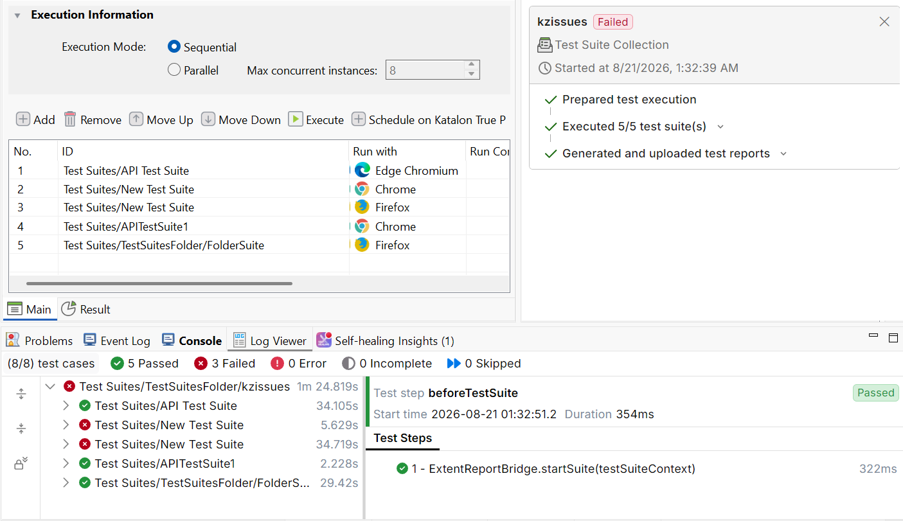
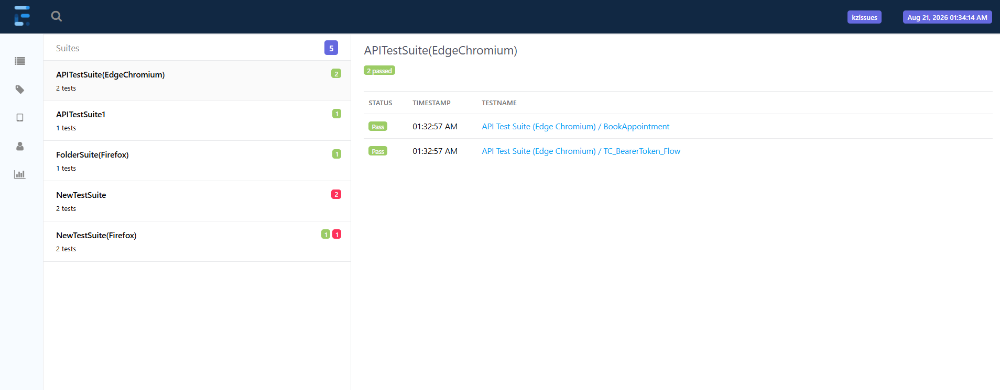
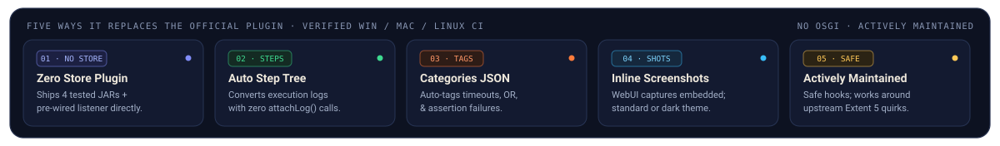
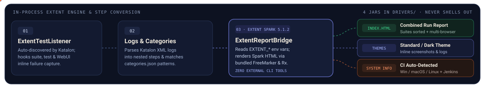
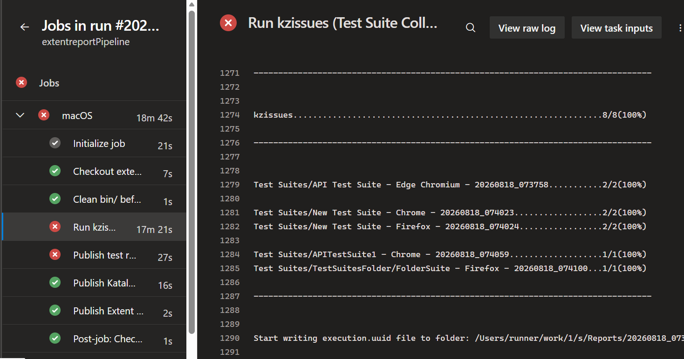
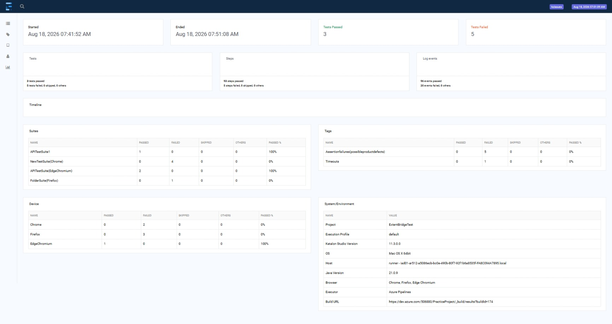
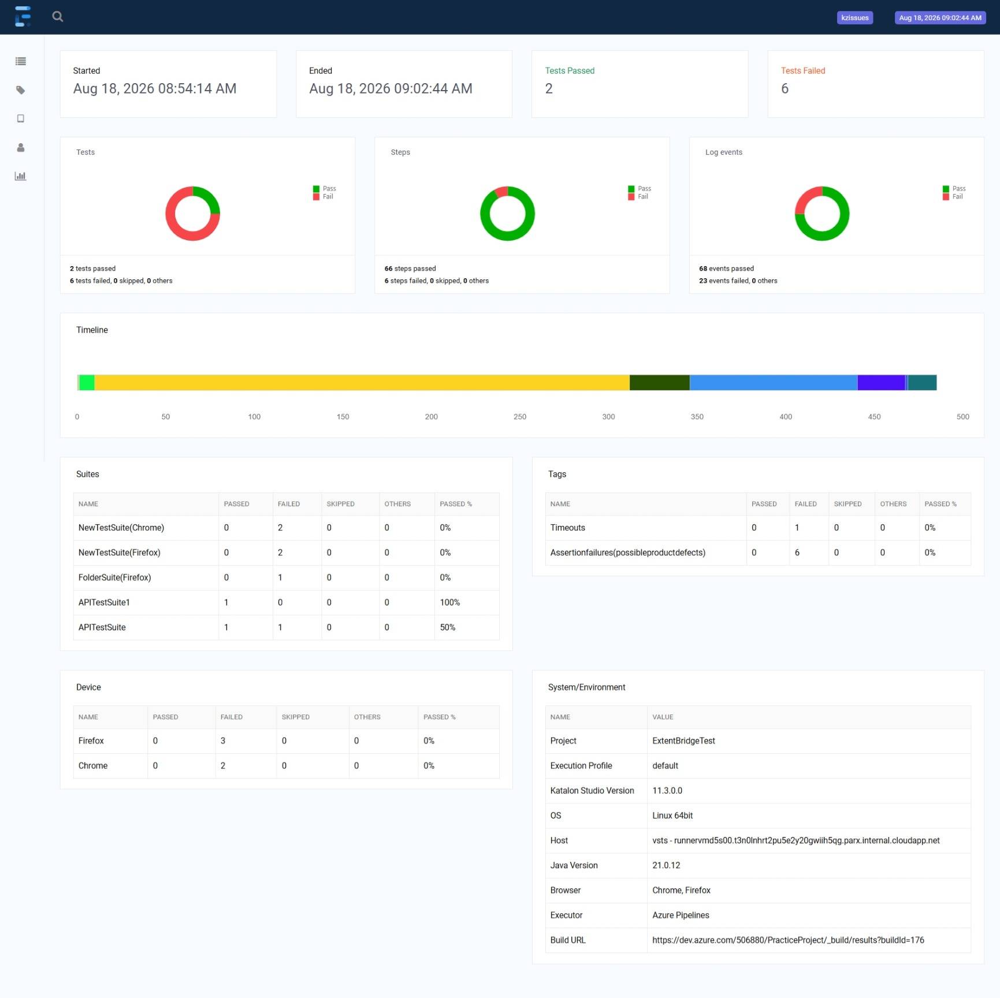
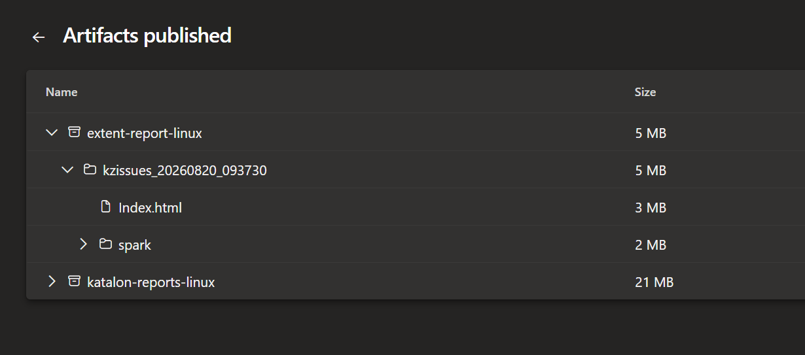

<div align="center">

<picture>
  <source media="(prefers-color-scheme: dark)" srcset="demo/images/hero-banner-dark.svg">
  <source media="(prefers-color-scheme: light)" srcset="demo/images/hero-banner-light.svg">
  
</picture>

<br><br>

[**See It in Action**](#see-it-in-action) &nbsp;·&nbsp;
[**Why Zero-Touch**](#why-zero-touch) &nbsp;·&nbsp;
[**Install**](#install--uninstall) &nbsp;·&nbsp;
[**Using It & Config**](#using-it--configuration) &nbsp;·&nbsp;
[**CI Setup**](#ci-setup) &nbsp;·&nbsp;
[**Contact Monty**](#lets-talk)

<br>

<a href="https://www.npmjs.com/package/extent-katalon-bridge"></a>
<a href="https://github.com/montbaga/extent-katalon-bridge/actions/workflows/ci.yml"></a>
<a href="LICENSE.md"></a>
<a href="https://github.com/montbaga/extent-katalon-bridge/commits/main"></a>
<a href="#lets-talk"></a>
<a href="https://github.com/sponsors/montbaga"></a>

</div>

<br>

> **Zero-touch Extent Reports for Katalon Studio:** Turn any Katalon project into an Extent Reports 5 project by double-clicking one file or running `npx` — **no plugin from the Katalon Store, no manual Test Listener authoring, no `CustomKeywords` / `attachLog()` pasted into test cases, and zero edits to Test Cases or Test Suites**. Read [`ARCHITECTURE.md`](ARCHITECTURE.md) for the full design.
>
> **A candid note on Extent Reports (`5.1.2`):** Its upstream maintainer marked Extent Reports sunset in early 2025 in favor of ChainTest. `5.1.2` continues working reliably and **this bridge is actively maintained** — bridge bugs are fixed directly, and upstream Extent quirks are worked around so reports stay accurate.

<br>

## See it in action

<table width="100%">
<tr>
<td width="33.3%" valign="top">
  <strong>1 · Zero-Touch Install</strong><br><br>
  One command or OS installer copies listener hooks, Keywords, config, and 4 bundled JARs — zero Store plugins or OSGi packaging.
</td>
<td width="33.3%" valign="top">
  <strong>2 · Auto Step Conversion</strong><br><br>
  Converts Katalon's own execution log into nested Extent steps with inline WebUI screenshots — zero manual <code>attachLog()</code> edits.
</td>
<td width="33.3%" valign="top">
  <strong>3 · In-Process &amp; Fault-Safe</strong><br><br>
  Renders <code>extent-report/&lt;Name&gt;_&lt;ts&gt;/Index.html</code> directly in Java (<code>standard</code> or <code>dark</code> theme); hooks isolate exceptions so tests never fail.
</td>
</tr>
</table>

<br>

<table>
  <tr>
    <td width="50%" valign="top"><br><sub><b>1 · Install in one command:</b> Run <code>npx extent-katalon-bridge install</code> or double-click your OS installer.</sub></td>
    <td width="50%" valign="top"><br><sub><b>2 · Run normally:</b> Execute any Test Suite, Collection, or lone Test Case as usual.</sub></td>
  </tr>
  <tr>
    <td width="50%" valign="top"><br><sub><b>3 · Generated in-project:</b> Standalone <code>extent-report/&lt;Name&gt;_&lt;timestamp&gt;/</code> lands straight inside your project.</sub></td>
    <td width="50%" valign="top"><br><sub><b>4 · Spark Dashboard:</b> Tests, Steps, Log events rings, multi-suite Timeline, and Suites summary.</sub></td>
  </tr>
</table>

<details>
<summary><b>Explore Steps, Categories &amp; Suites views (3 more report tabs)</b></summary>

<table>
  <tr>
    <td width="33.3%" valign="top"><br><sub><b>Tests &amp; steps:</b> Nested Katalon execution steps &amp; timings.</sub></td>
    <td width="33.3%" valign="top"><br><sub><b>Categories:</b> Automatic failure classification via <code>categories.json</code>.</sub></td>
    <td width="33.3%" valign="top"><br><sub><b>Suites:</b> Alphabetical suite + browser breakdown across Collections.</sub></td>
  </tr>
</table>

</details>

---

## Why zero-touch

<picture>
  <source media="(prefers-color-scheme: dark)" srcset="demo/images/five-pillars-dark.svg">
  <source media="(prefers-color-scheme: light)" srcset="demo/images/five-pillars-light.svg">
  
</picture>

<br><br>

| Problem with the official plugin path | How this bridge solves it |
| :--- | :--- |
| **Store plugin &amp; version lock-in** | Ships the 4 exact JARs directly inside `Drivers/` — zero Store download or OSGi packaging |
| **Hand-authoring Test Listeners** | Ships a pre-wired auto-discovered listener — `Test Listeners/ExtentTestListener.groovy` |
| **Pasting `attachLog()` in every script** | Auto-converts Katalon's execution log into nested Extent steps by default |
| **Reporting bugs breaking tests** | Every hook catches exceptions and logs warnings without changing test verdicts |

<details>
<summary><b>Requirements, installer behavior &amp; all 13 installed files (including Linux JDK 21 &amp; Maven JAR fetcher)</b></summary>

- **Requirements:** Katalon Studio (Java 17/21 runtime) on Windows, macOS, or Linux — zero external CLI tools required (in-process Java generation via 4 JARs in `payload/Drivers/`). On **Linux**, Katalon `11.3.0+` OSGi bundles require JavaSE 21 (`JAVA_HOME` set to JDK 21).
- **What the installer does:**
  1. Verifies the target folder contains a `*.prj` Katalon project file before writing anything.
  2. Copies the Listener, Keywords, config, `Drivers/` JARs, and launcher helpers.
  3. Preserves an existing `extent.properties` unless `--force` / `-Force` is passed.
  4. Tracks installed paths in `.extent-bridge/manifest.txt` so uninstall cleanly removes only bridge files.
  5. Registers the 4 JARs in `.classpath` (when present) so Katalon resolves Extent classes without extra manual steps. Re-running upgrades in place.

```text
Test Listeners/ExtentTestListener.groovy       auto-discovered by Katalon — the only wiring needed
Keywords/extent/ExtentReportBridge.groovy      engine: lifecycle mapping, step capture, report assembly
Keywords/extent/ExtentConfig.groovy            extent.properties reader + EXTENT_* env var overrides
Keywords/extent/ExtentKeywords.groovy          optional API: step(), info/warning/pass/fail(), attachScreenshot()
Include/config/extent/extent.properties        configuration
Include/config/extent/categories.json          failure categorization tuned to Katalon/Selenium exception types
Drivers/extentreports-5.1.2.jar                Apache-2.0, Extent Framework
Drivers/freemarker-2.3.32.jar                  Apache-2.0, Apache Software Foundation
Drivers/rxjava-3.1.6.jar                       Apache-2.0, RxJava Contributors
Drivers/reactive-streams-1.0.4.jar             CC0 1.0 (public domain)
Drivers/fetch-extent-jars.ps1                  sha1-verified Maven Central fetcher if your org omits binary JARs in git
View Extent Report.bat / .command              optional convenience helper to open the latest Index.html (Win / macOS)
view-extent-report.sh                          same helper for Linux/CI
```

- **Do you need `View Extent Report`?** No — every run already writes a standalone `extent-report/<Name>_<timestamp>/Index.html` you can open directly in any browser without a server.

</details>

---

## Install &amp; uninstall

<table width="100%">
<tr>
<td width="33.3%" valign="top">
  <strong>1 · npm / npx (Any OS)</strong><br><br>
  <pre>npx extent-katalon-bridge install &lt;dir&gt;
npx extent-katalon-bridge uninstall &lt;dir&gt;</pre>
  Add <code>--force</code> on install or <code>--remove-config</code> on uninstall when needed.
</td>
<td width="33.3%" valign="top">
  <strong>2 · Double-Click OS Installers</strong><br><br>
  • <b>Windows:</b> <code>Windows\Install.bat</code><br>
  • <b>macOS:</b> <code>macOS\Install.command</code><br>
  • <b>Linux:</b> <code>./Linux/install.sh &lt;dir&gt;</code>
</td>
<td width="33.3%" valign="top">
  <strong>3 · GitHub Actions</strong><br><br>
  <pre>- uses: montbaga/extent-katalon-bridge@v1
  with:
    project-path: .</pre>
  Works directly from the tagged Action — zero npm or clone steps needed.
</td>
</tr>
</table>

<details>
<summary><b>All OS commands, drag-and-drop, global npm &amp; config preservation flags</b></summary>

- **Global npm reuse:** `npm install -g extent-katalon-bridge` then `extent-katalon-bridge install "/path/to/your/katalon/project"`.
- **Windows GUI, drag-and-drop, &amp; PowerShell:** Double-click `Windows\Install.bat` / `Windows\Uninstall.bat`, drag a project folder directly onto either `.bat`, or script via PowerShell:
  ```powershell
  .\Windows\install.ps1 -ProjectPath "C:\path\to\your\katalon\project"      # add -Force to overwrite extent.properties
  .\Windows\uninstall.ps1 -ProjectPath "C:\path\to\your\katalon\project"    # add -RemoveConfig to delete properties & categories
  ```
- **macOS &amp; Linux CLI:** Double-click `macOS\Install.command` / `Uninstall.command`, or run the shared bash engine (prompts if path is omitted):
  ```bash
  ./Linux/install.sh /path/to/your/katalon/project      # add --force to overwrite customized config
  ./Linux/uninstall.sh /path/to/your/katalon/project    # add --remove-config to remove config files
  ```
- Uninstalling removes only bridge-installed files and preserves `extent.properties`, `categories.json`, `extent-results/`, and `extent-report/` unless overridden with `--force` / `--remove-config`.

</details>

---

## Using it &amp; configuration

<picture>
  <source media="(prefers-color-scheme: dark)" srcset="demo/images/lifecycle-flow-dark.svg">
  <source media="(prefers-color-scheme: light)" srcset="demo/images/lifecycle-flow-light.svg">
  
</picture>

<br><br>

- **Zero-touch output:** After reopening/refreshing your project, every run generates `extent-report/<Name>_<timestamp>/Index.html` (`<Name>` = Test Suite Collection name, Test Suite name, or lone Test Case name) containing nested step trees, inline base64 failure screenshots (WebUI only, no loose image files), and automatic failure categories from `Include/config/extent/categories.json`.
- **Collections &amp; multi-browser suites:** A Collection emits **one combined report** sorted alphabetically in the Suites tab; duplicate suite runs appear separately with browser labels (omitting labels cleanly on API-only runs or WebUI sessions that failed before opening a browser).
- **Opt-in Groovy helpers (`ExtentKeywords`):** Layer custom business steps, manual messages, or extra screenshots whenever useful:

```groovy
CustomKeywords.'extent.ExtentKeywords.step'('Log in as admin', {
    WebUI.setText(findTestObject('Page/input_Username'), 'admin')
    WebUI.click(findTestObject('Page/button_Login'))
})
CustomKeywords.'extent.ExtentKeywords.info'('Using seeded test account #4')
CustomKeywords.'extent.ExtentKeywords.attachScreenshot'('Before checkout')
```

<details>
<summary><b>All 10 configuration keys (<code>Include/config/extent/extent.properties</code> + <code>EXTENT_*</code> env vars)</b></summary>

Override any key in `extent.properties` or via `EXTENT_<KEY_IN_UPPER_SNAKE_CASE>` (e.g. `extent.results.dir` → `EXTENT_RESULTS_DIR`):

| Key | Default | Meaning |
| :--- | :--- | :--- |
| `extent.enabled` | `true` | Master bridge switch |
| `extent.results.dir` | `extent-results` | Intermediate per-test records |
| `extent.clean.results.before.run` | `true` | Clear prior records before each suite starts |
| `extent.attach.screenshot.on.failure` | `true` | Inline screenshot on any non-`PASSED` status (WebUI only) |
| `extent.attach.screenshot.always` | `false` | Capture screenshot on every test case |
| `extent.categories.file` | `Include/config/extent/categories.json` | Failure categorization rules |
| `extent.auto.generate.report` | `true` | Assemble `Index.html` in-process at run end (no external CLI) |
| `extent.report.dir` | `extent-report` | Base directory for `<Name>_<timestamp>/` outputs |
| `extent.report.theme` | `standard` | `standard` or `dark` Spark theme |
| `extent.capture.steps` | `true` | Auto-convert Katalon's execution log into nested steps |

</details>

---

## CI setup

Verified end to end across **Windows, macOS, and Linux** hosted Azure Pipelines agents (plus GitHub Actions and GitLab CI) using the same Test Suite Collection unmodified — and CI metadata (`Jenkins`, `Azure Pipelines`, `GitHub Actions`, `GitLab CI`) populates the System Info panel automatically. Full example in [`azure-pipelines.example.yml`](azure-pipelines.example.yml).

<table>
  <tr>
    <th>Platform</th>
    <th>Hosted Agent Run</th>
    <th>Generated Extent Report</th>
    <th>Published Build Artifact</th>
  </tr>
  <tr>
    <td><b>Windows</b></td>
    <td></td>
    <td></td>
    <td></td>
  </tr>
  <tr>
    <td><b>macOS</b></td>
    <td></td>
    <td></td>
    <td></td>
  </tr>
  <tr>
    <td><b>Linux</b></td>
    <td></td>
    <td></td>
    <td></td>
  </tr>
</table>

<details>
<summary><b>Complete CI guides (Azure Pipelines, GitHub Actions <code>@v1</code> &amp; GitLab CI Docker Chrome note)</b></summary>

| Platform | Ready-to-Copy Config | Setup Summary |
| :--- | :--- | :--- |
| **Azure Pipelines** | [`azure-pipelines.example.yml`](azure-pipelines.example.yml) | Install **Execute Katalon Studio Tests** extension; create variable group `Katalon` (`KatalonApiKey`); swap `<YourCollection>` (`-testSuiteCollectionPath` or `-testSuitePath`); download `katalon-reports` &amp; `extent-report` from **Summary → Artifacts** |
| **GitHub Actions** | [`github-actions.example.yml`](github-actions.example.yml) | Add repo secret `KATALON_API_KEY`; swap `<YourCollection>`; runs via `uses: montbaga/extent-katalon-bridge@v1` cleanly without npm; publishes artifacts under the **Actions** run summary |
| **GitLab CI** | [`gitlab-ci.example.yml`](gitlab-ci.example.yml) | Add masked variable `KATALON_API_KEY`; uses official `katalonstudio/katalon` Docker image (**Chrome**, not Edge — adjust `-browserType` accordingly); outputs under **Job artifacts** |

</details>

---

## Sponsors, support &amp; license

<details>
<summary><b>Support promise, Sponsor tiers, Backers &amp; <code>Apache-2.0</code> / <code>CC0</code> JAR licenses</b></summary>

### Active Maintenance Commitment
Bugs in this bridge's own code are fixed directly, and where upstream Extent Reports `5.1.2` has quirks that break report accuracy, this bridge implements workarounds rather than leaving reports broken.

### Sponsor via [GitHub Sponsors](https://github.com/sponsors/montbaga)
| Tier | Price | Gets You |
| :--- | :--- | :--- |
| **Coffee** | \$5/mo | Your name listed in Backers |
| **Backer** | \$15/mo | Above + priority attention on your issues |
| **Company** | \$100/mo | Company logo and site link near the top of this README |
| **Priority Partner** | \$199/mo | Above + direct email help wiring the bridge into your CI setup |

Thanks to everyone supporting ongoing maintenance across Katalon &amp; CI toolchains.

### License ([`LICENSE.md`](LICENSE.md)) &amp; Internals ([`ARCHITECTURE.md`](ARCHITECTURE.md))
Apache License 2.0 · Copyright 2026 Monty Bagati. Bundled `payload/Drivers/` components remain under their own licenses: `extentreports-5.1.2.jar` (© Anshoo Arora / Extent Framework, Apache-2.0), `freemarker-2.3.32.jar` (Apache-2.0), `rxjava-3.1.6.jar` (Apache-2.0), and `reactive-streams-1.0.4.jar` (CC0 1.0 Universal public domain).

</details>

---

## Let's talk

<div align="center">

<picture>
  <source media="(prefers-color-scheme: dark)" srcset="demo/images/contact-card-dark.svg">
  <source media="(prefers-color-scheme: light)" srcset="demo/images/contact-card-light.svg">
  
</picture>

<br><br>

<a href="mailto:bagati.monty@gmail.com?subject=Extent-Katalon%20Bridge%20%E2%80%94%20Hello%20Monty"></a>
&nbsp;
<a href="https://www.linkedin.com/in/monty-bagati-90454626/"></a>
&nbsp;
<a href="https://github.com/montbaga"></a>
&nbsp;
<a href="https://github.com/montbaga/extent-katalon-bridge/issues/new"></a>

<br><br>

**Extent-Katalon Bridge `v1.0.2`** · Built by [**Monty Bagati**](https://www.linkedin.com/in/monty-bagati-90454626/)  
<sub>Apache License 2.0 · Copyright 2026 Monty Bagati · Bundled jars Apache-2.0 / CC0</sub>

</div>
